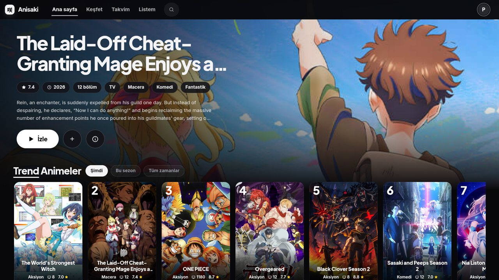
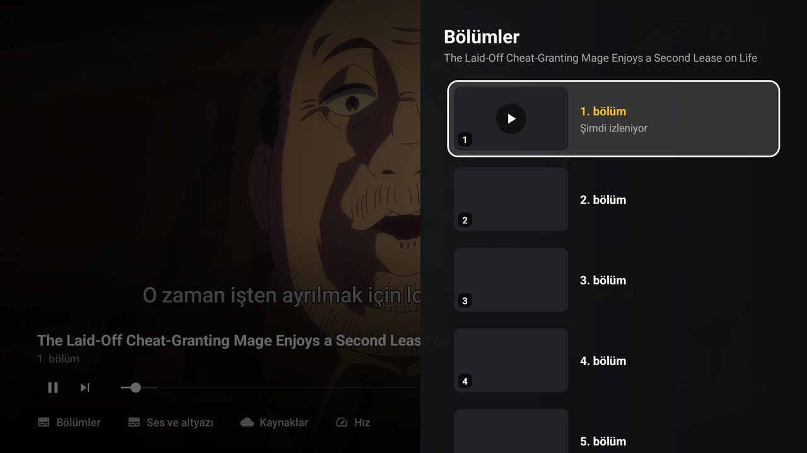
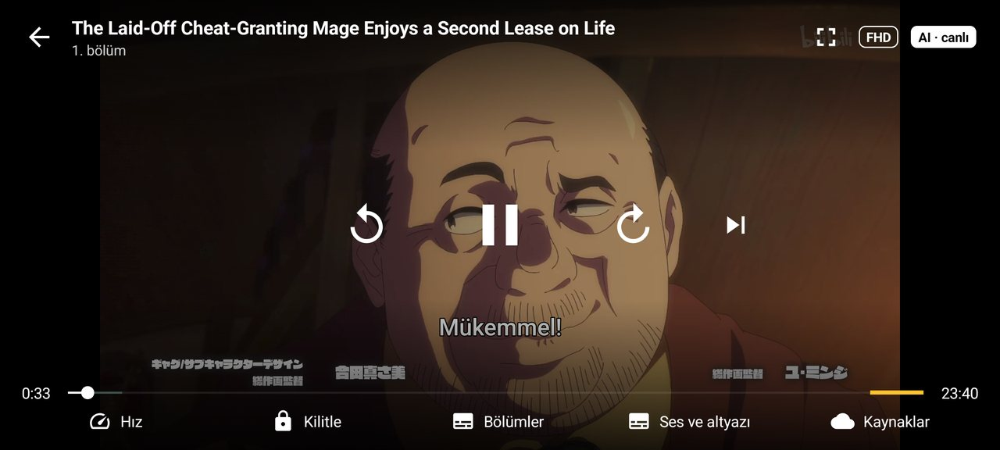
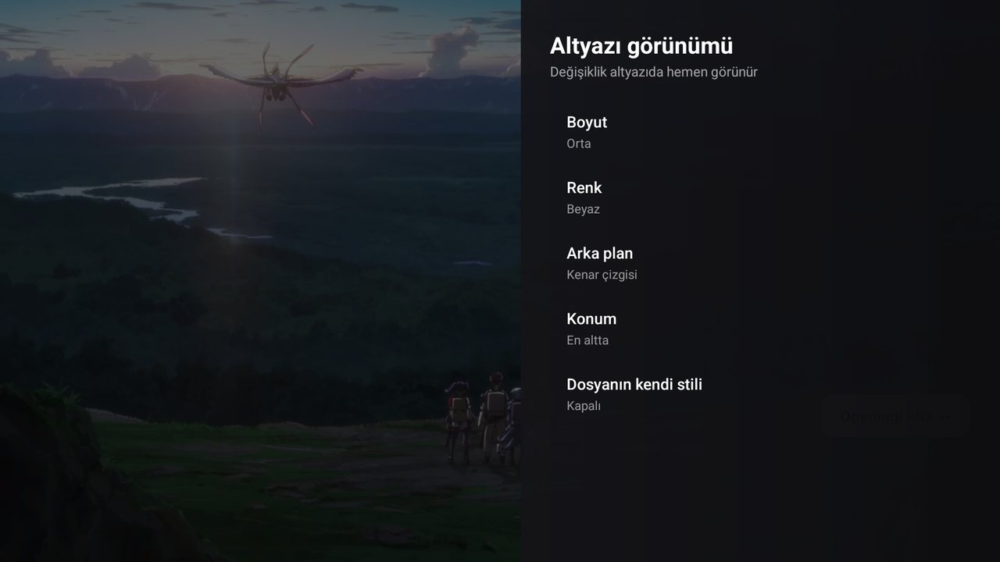
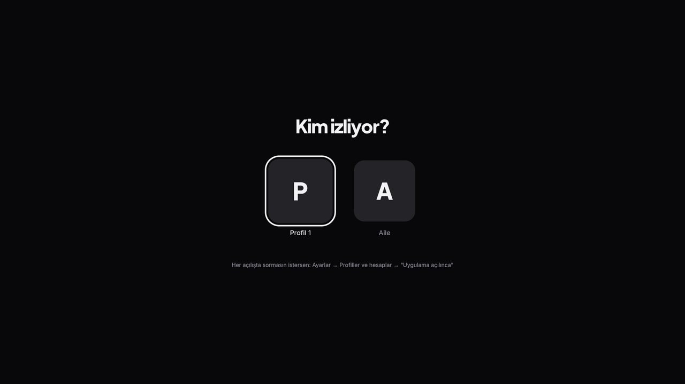

# Anisaki

**Sürüm 0.1.1 · alfa**

Anime izlemek için Windows, Android telefon ve Android TV uygulaması.

**[⬇ İndir (Windows · Android · TV)](https://github.com/blaidq-a/anisaki/releases/latest)**

AniList'teki her animeyi bulur, Stremio uyumlu eklentilerden ve torrentten kaynak arar, en iyisini kendisi seçip oynatır. Türkçe altyazısı olmayan bölümlerin İngilizce altyazısını, anime altyazılarıyla eğitilmiş bir yapay zekâ modeliyle **cihazın kendisinde, internetsiz** Türkçeye çevirir.

| TV ana sayfa | Anime sayfası |
|---|---|
|  |  |

| Oynatıcı, AI Türkçe altyazıyla | Ses ve altyazı | Bölümler |
|---|---|---|
|  |  |  |

| Telefon | Telefonda anime sayfası | Telefonda oynatıcı |
|---|---|---|
|  |  |  |

| Altyazı görünümü | Kim izliyor? |
|---|---|
|  |  |

## Kurulum

- **Windows:** `Anisaki_…_x64-setup.exe` dosyasını indirip çalıştır. İmzasız olduğu için Windows SmartScreen uyarı verebilir: "Ek bilgi" → "Yine de çalıştır".
- **Android telefon ve TV:** `Anisaki-….apk` dosyasını indirip kur (bilinmeyen kaynaklardan yüklemeye izin vermen gerekir).
- **Güncelleme:** Yeni sürüm çıkınca uygulama açılışta sorar; "Şimdi güncelle" ile kurulur.

## Neler yapıyor

- **Katalog:** Trendler, sezonlar, takvim, arama; bölüm adları, görseller ve logolar.
- **Kaynaklar:** Stremio eklentileri, Real-Debrid / TorBox ve yerleşik torrent. En iyi kaynak kalite, seed ve dile göre kendiliğinden seçilir; istersen listeden elle seçersin.
- **AI Türkçe altyazı:** Türkçe altyazı yoksa İngilizcesi cihazın kendisinde, internetsiz çevrilir.
- **Altyazı senkronu:** Altyazı videonun sesiyle karşılaştırılır; kayıksa kendiliğinden düzeltilir, uymuyorsa başka altyazı seçilir.
- **Oynatıcı:** Opening/ending atlama, sonraki bölüme geçiş, oynatıcıdan çıkmadan bölüm ve kaynak değiştirme, altyazı görünümü ayarları. PC'de Anime4K.
- **TV:** Kumandayla kullanım için tasarlanmış arayüz; hesap bağlamak için ekrandaki QR kodu telefonla okutman yeterli.
- **Profiller:** "Kim izliyor?" ekranı, her profilin kendi listesi; AniList ve MyAnimeList ile izleme ilerlemesi eşitlenir.

## Bilinen sınırlar (alfa)

- Telefonda ve TV'de bir ayarı değiştirdikten hemen sonra uygulama zorla kapatılırsa son değişiklik kaybolabilir.
- Bu bir alfa sürümü; hata bulursan [Issues](https://github.com/blaidq-a/anisaki/issues) sayfasına yazabilirsin.

Geliştiriciler için: [docs/GELISTIRME.md](docs/GELISTIRME.md)
