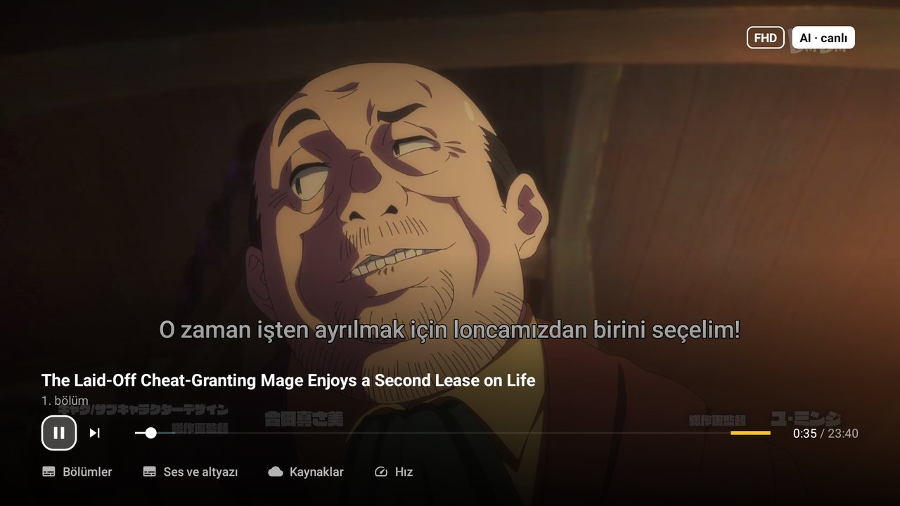
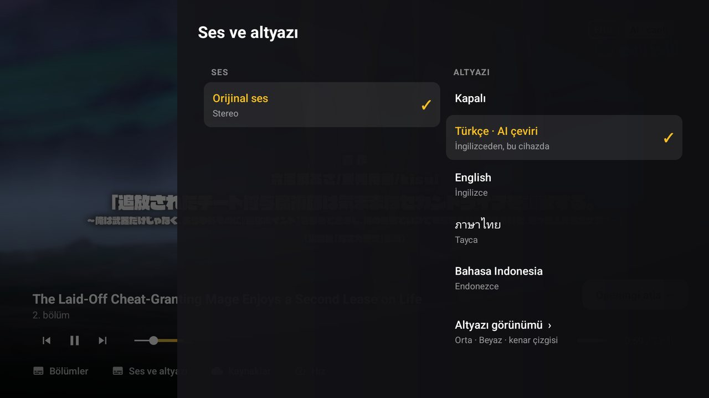
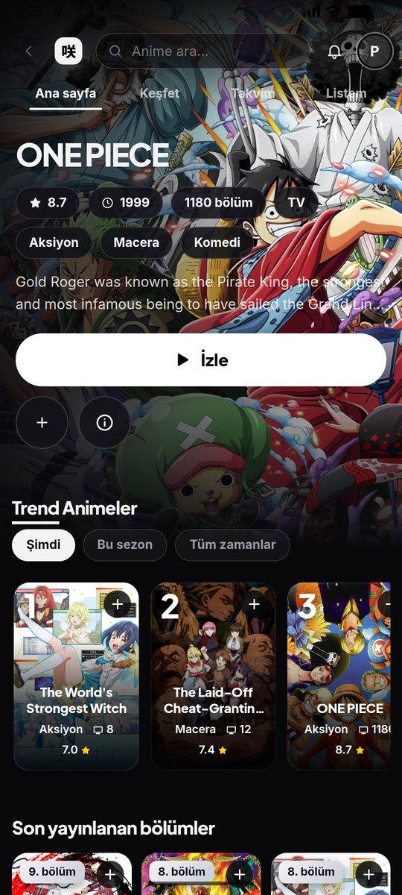
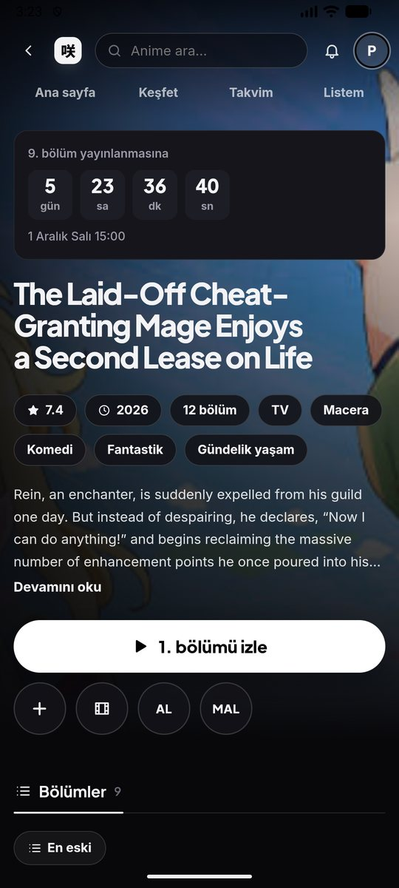

# Anisaki

**Sürüm 0.1.1 · alfa**

Anime izlemek için Windows, Android telefon ve Android TV uygulaması. AniList'teki her animeyi bulur, Stremio uyumlu eklentilerden ve torrentten kaynak arar, en iyisini kendisi seçip oynatır. Türkçe altyazısı olmayan bölümlerin İngilizce altyazısını, anime altyazılarıyla eğitilmiş bir yapay zekâ modeliyle **cihazın kendisinde, internetsiz** Türkçeye çevirir.

| TV ana sayfa | Anime sayfası |
|---|---|
|  |  |

| Oynatıcı, AI Türkçe altyazıyla | Ses ve altyazı | Bölümler |
|---|---|---|
|  |  |  |

| Telefon | Telefonda anime sayfası | Telefonda oynatıcı |
|---|---|---|
|  |  |  |

| Altyazı görünümü | Kim izliyor? |
|---|---|
|  |  |

## Neler yapıyor

- **Katalog:** AniList'ten trendler, sezon, takvim, arama; ani.zip ve TheTVDB'den bölüm adları, görseller ve logolar.
- **Kaynaklar:** Stremio eklentileri, Real-Debrid / TorBox ve yerleşik torrent istemcisi (librqbit). Kaynak kalite, seed ve dil bilgisine göre otomatik seçilir; istenirse listeden elle seçilir.
- **AI Türkçe altyazı:** İngilizce altyazı satır satır cihazda çevrilir (ONNX Runtime). Oynatıcı altyazıyı tamponlandığı anda okur ve satırlar ekrana gelmeden çevrilir. Ekrandaki satır her zaman önce çevrilir, İngilizcesi hiç görünmez.
- **Oynatıcı:** PC'de gömülü mpv (Anime4K desteğiyle), telefonda ve TV'de ExoPlayer. OP/ED atlama, sonraki bölümü bitmeden hazırlama, oynatıcıdan çıkmadan bölüm ve kaynak değiştirme, altyazı görünümü ayarları (boyut, renk, arka plan, konum).
- **TV:** Kumanda için yapılmış arayüz; Netflix benzeri oynatıcı kontrolleri, sağdan açılan bölüm / ses-altyazı / kaynak panelleri.
- **Profiller:** "Kim izliyor?" ekranı, her profilin kendi listesi; AniList ve MyAnimeList ile izleme ilerlemesi eşitlemesi.
- **Güncelleme:** Ayarlar → Genel → Sürüm ve güncellemeler (tek tıkla kurulum; dağıtım adresi ayarlanınca açılır, bkz. `src/renderer/src/lib/update.ts`).

## Yapı

| Klasör | Ne var |
|---|---|
| `src/renderer/` | Ortak React arayüzü (PC, telefon ve TV aynı arayüzü kullanır) |
| `src/main/` | Ayarlar, çeviri ve eklenti mantığı (arayüzle aynı süreçte çalışır) |
| `src-tauri/` | PC uygulaması: Tauri 2 + Rust (mpv, torrent, AI çeviri, AniList girişi, güncelleme) |
| `mobile/` | Telefon / TV uygulaması: Tauri 2 Android; `mobile/src` arayüz eklemeleri ve TV kumanda gezinmesi |
| `mobile/src-tauri/gen/android/.../anisaki/mobile/` | ExoPlayer oynatıcısı (`PlayerActivity`), önden okuyan altyazı bileşeni (`CueRenderer`), eklenti köprüsü (`PlayerPlugin`) |

## Derleme

```powershell
npm install
npm run vendor     # mpv ve ffmpeg'i vendor/ klasörüne indirir (git'te tutulmaz; çeviri modeli vendor/toz-anime'ye ayrıca konur)
npm run dev        # PC, geliştirme modu
npm run build      # PC kurulum dosyası (.exe)
```

Telefon / TV (Android Studio JBR, Android SDK ve NDK gerekir):

```powershell
cd mobile
npm run apk        # telefon (arm64) ve TV (armv7) için APK
```

API anahtarları ve istemci kimlikleri depoda tutulmaz: `scripts/embed-key.cjs` derlemeden önce yerel `*.gen.ts` dosyalarına yazar (bu dosyalar `.gitignore`'dadır).

## Bilinen sınırlar (alfa)

- Telefonda ve TV'de ayarlar WebView depolamasında tutulur; uygulama bir değişiklikten hemen sonra zorla kapatılırsa son değişiklik kaybolabilir.
- TV'de AniList / MAL hesabı bağlamak henüz yok (QR ile telefondan bağlama planlanıyor).
- mpv (GPL/LGPL), ffmpeg (GPL), ExoPlayer (Apache 2.0) ve Anime4K (MIT) ayrı lisanslıdır.
